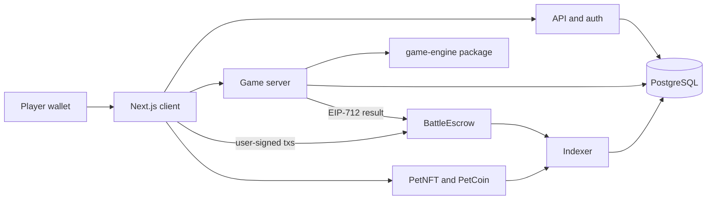
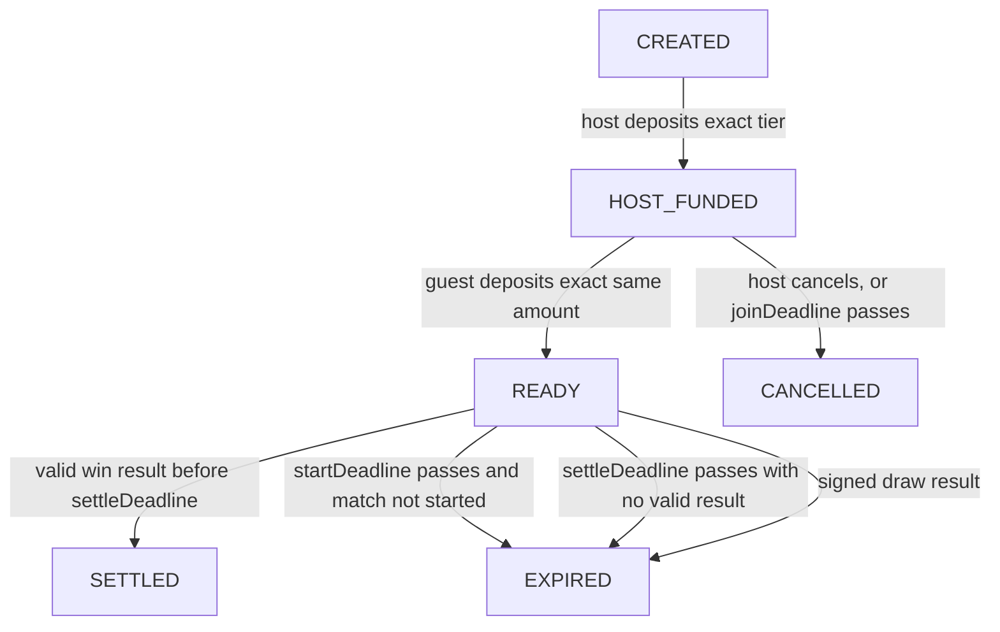

# Pet Fight Architecture

**Status:** Locked for implementation planning  
**Date:** 2026-10-27  
**Spec:** [PRODUCT_SPEC.md](PRODUCT_SPEC.md) v1.2  
**Decisions:** [OPEN_DECISIONS.md](OPEN_DECISIONS.md)  
**Build order:** [ROADMAP.md](ROADMAP.md)

This document is the engineering architecture. It records the component boundaries, custody rules, and the canonical settlement payload. Product narrative stays in the spec. Items still unresolved stay in the decision log. Coding must not fill those in.

Escrow rules live here until a later phase splits them into `docs/ECONOMY_AND_ESCROW.md`.

## Authority

Three sources of truth, each for a different fact:

| Fact | Authority |
|---|---|
| Damage, RNG, wind, hit zone, round winner | Game server, via `packages/game-engine` |
| What the players saw and can replay | Append-only transcript |
| NFT ownership, PETC balances, deposits, prize payout, refunds | Robinhood Chain contracts |
| Lobby lists, profiles, match UI | PostgreSQL read model, rebuilt from chain events and the transcript |

The browser renders server state. It may run the same engine for prediction. A client-submitted damage total, health value, seed, or winner is ignored.

An authorized result signer is an operational assumption. It is not a fairness proof. The MVP controls are the replay transcript, the seed reveal, and a permissionless refund deadline. Product copy must not call settlement trustless.

## Components



| Piece | Responsibility |
|---|---|
| `apps/web` | Wallet connection, lobby, battle view, balances. No authoritative combat. |
| `apps/api` | Nonce auth, quotes, room metadata, reads. Quotes are not proof of payment. |
| `apps/game-server` | Match state machine, turn timers, transcript writes, seed commit and reveal. |
| `packages/game-engine` | Shared deterministic rules. Server and replay use this package. |
| `apps/indexer` | Contract events into PostgreSQL. Idempotent on `(chain_id, tx_hash, log_index)`. |
| `contracts/BattleEscrow.sol` | Deposits, deadlines, one-time settlement, refunds. |
| `contracts/PetNFT.sol` | Pet ownership and compact progression. |
| `contracts/PetCoin.sol` | PETC balances. |
| Settlement relayer | Submits the signed result and pays ETH gas. Anyone may submit the same signature. |

Target layout when coding starts, matching spec §16: `apps/web`, `apps/api`, `apps/game-server`, `apps/indexer`, `packages/game-engine`, `packages/shared-types`, `packages/contract-clients`, `packages/config`, and `contracts/` with Foundry (`src/`, `test/`, `script/`, `foundry.toml`). This architecture slice does not create those directories.

Stack from spec §9.1: TypeScript, Next.js, Solidity, Foundry, OpenZeppelin, PostgreSQL, Redis, WebSockets. Battle rendering (Phaser 3 or PixiJS) is chosen when a battle view is built. The first combat work is a headless engine and a JSON replay.

## Chain configuration

Target chain is Robinhood Chain. Gas is paid in ETH. Chain id, RPC, and explorer come from environment config, not from scattered constants.

Planning assumptions, pending a check of the official docs before any deploy script:

- Mainnet chain id `4663`
- Testnet chain id `46630`
- Explorer host `robinhoodchain.blockscout.com`

Confirmation:

- **Deposits.** The indexer may treat a deposit as confirmed when the transaction is included in a sequencer block. Funds remain in escrow, so this is the signal to show the room as funded.
- **Settlement and redemption bookkeeping.** The UI shows two states: submitted, and posted to Ethereum. The depth that counts as posted stays unset until official finality docs are read.
- The indexer applies reorgs and re-sequencing idempotently. A removed log reverses the read model; it does not mint a second payout.

## Amounts

PETC uses 18 decimals. A stake tier is the human unit. The on-chain amount is `tier * 10^18`.

| Human tier | On-chain amount (wei) |
|---:|---|
| 10 | `10 * 10^18` |
| 20 | `20 * 10^18` |
| 50 | `50 * 10^18` |
| 100 | `100 * 10^18` |
| 1,000 | `1000 * 10^18` |

Database token amounts are `NUMERIC(78,0)` in wei. `battle_rooms.stake_tier` stores the human tier (`10`, `20`, `50`, `100`, or `1000`). Addresses are stored lowercase and rendered checksummed. Every chain-derived row carries `chain_id`.

Code uses `stakeTier` for the entry amount. Pet level is a separate field. The word `level` is not a name for a room, a tier, or a pot.

## Rules identity

Every match and every funded room commits to:

- `rulesVersion` — monotonically increasing integer
- `rulesHash` — `keccak256` of the canonical rules JSON for that version

Both are fixed for the life of the room. A balance change requires a new version and a new hash. Running matches keep the version they started with.

`rulesVersion` 1 accepts the combat rules in [OPEN_DECISIONS.md](OPEN_DECISIONS.md). Coefficients the spec leaves unnamed are Phase 1 inputs. They are written into the rules file before engine code, then frozen for that version.

## On-chain room machine

`IN_PROGRESS` and `RESULT_PENDING` are off-chain match states. The contract does not treat "the backend says the match started" as authority to take the pot.

On-chain states:



`CANCELLED` and `EXPIRED` both refund the deposits that are actually held. A host-only refund returns the host deposit. A both-funded refund returns each deposit in full. Refunds charge no fee.

`DISPUTED` is an off-chain operations status. The contract has no function that lets an admin choose a winner or change a funded room's stake, fee snapshot, or players.

### Three deadlines

One expiry timestamp would either refund a live match or leave funds stuck. Each room stores three deadlines.

| Deadline | When it is set | Who can act | Effect |
|---|---|---|---|
| `joinDeadline` | Room creation | Host at any time before a guest deposits; anyone after the deadline | Refund the host. Room becomes `CANCELLED` or `EXPIRED`. |
| `startDeadline` | Guest deposit, while status is `READY` and `startedAt == 0` | Anyone after the deadline | Refund both deposits. |
| `settleDeadline` | `markStarted` | Anyone after the deadline if no valid result was submitted | Refund both deposits. A valid result submitted earlier still settles. |

`markStarted(roomId)` may be called by either player or the settlement relayer. It records `startedAt` and sets `settleDeadline`. It does not move tokens. It is not authorization to take the pot.

Pause stops new rooms and new deposits. Refunds, and a settlement whose signature was produced before the pause, stay callable.

### Deposits

- The allow-list of tiers is 10, 20, 50, 100, and 1,000. Adding or removing a tier is a timelocked admin action and does not affect rooms already created.
- Host and guest each transfer the exact wei amount for that tier. The token must be the room's PETC.
- Same-address self-join is rejected. A third participant is rejected.
- Preferred entry path is EIP-2612 `permit` so create-and-deposit is one transaction. Otherwise `approve` the exact tier amount. Unlimited allowance is not requested.
- The host's pet token id and the guest's pet token id are stored on the room. Combat uses the stat snapshot taken at funding. A later transfer does not replace the combatant and does not remove the pet from the match.
- Public listing is a product feature. Privacy of an invite link is not a security boundary.

### Fees

`feeBps` is copied into the room at creation. The working value is `0`. The contract constant `MAX_FEE_BPS` is `500`. A later timelocked parameter change cannot set a new room's fee above that constant.

```text
fee = pot * feeBps / 10_000
payout = pot - fee
```

Integer division rounds down. With `feeBps = 0`, a 20 + 20 room pays the winner 40 coins and the loser 0 from the pot. A match-level draw refunds 20 to each player.

### One match per room

```text
matchId = keccak256(abi.encode(roomId, uint256(1)))
```

`roomId` is a `uint256` assigned by the contract. A rematch creates a new room.

## EIP-712 result

Domain separator fields:

| Field | Value |
|---|---|
| name | `BattleEscrow` |
| version | `1` |
| chainId | The chain this deployment is on |
| verifyingContract | This contract's address |

A signature from another chain or another deployment does not verify.

Primary type `MatchResult`:

| Field | Solidity type | Rule |
|---|---|---|
| `matchId` | `bytes32` | Must equal `keccak256(abi.encode(roomId, uint256(1)))` |
| `roomId` | `uint256` | The funded room |
| `rulesVersion` | `uint32` | Must equal the room's snapshotted version |
| `rulesHash` | `bytes32` | Must equal the room's snapshotted hash |
| `player1` | `address` | Host |
| `player2` | `address` | Guest |
| `winner` | `address` | See below |
| `player1Rounds` | `uint8` | Rounds won by the host |
| `player2Rounds` | `uint8` | Rounds won by the guest |
| `transcriptHash` | `bytes32` | Hash of the canonical transcript |
| `deadline` | `uint256` | Block timestamp must be strictly before this value |

Winner rules:

- A payout requires `winner` to be `player1` or `player2`, that player to have the greater round count, and that count to be at least 2. The contract pays `payout` once and records the transcript hash.
- A draw refund requires `winner == address(0)`, both round counts below 2, and `deadline` still valid. The contract refunds both deposits in full and records the transcript hash. This is the on-chain form of a match-level draw from spec §5.1.
- Any other winner is rejected. A second successful settlement or refund for the same `matchId` is rejected.

The contract checks the signature, the room state, the pot balance, and these fields. It does not re-simulate the battle. The current authorized signer must have signed the struct. After a signer rotation, old unsubmitted signatures die; the relayer signs again with the new key. The signer cannot withdraw escrow. There is no admin override of the winner.

Settlement submission is permissionless: the relayer is expected to submit and pay gas, and either player may submit the same signature. Players can always submit their own refund after the relevant deadline, including when the relayer's ETH balance is empty.

## Combat engine boundary

`packages/game-engine` is pure and deterministic:

- Integer values scaled by 1,000
- Seeded PRNG inside the package
- No `Math.random()`
- No floating-point trigonometry in authoritative code

Before round 1 the server publishes `hash(serverSeed)` to both players. After the match it reveals `serverSeed`. Each player's per-match client seed is mixed in, so wind is fixed before throws are chosen. The transcript records, for every shot, the zone, contact point, multiplier, and final damage.

Same-step head and body contact: the earlier contact wins; an exact tie is body. Damage uses integer floor. No single hit exceeds 40% of the defender's max health. Zone defense is per zone. Rules version 1 has no equipment, so zone defense is 0.

Species abilities and bird evasion are outside version 1. The dog-vs-cat prototype implements normal throw, power shot, sniping shot, double attack, heal, and pass.

## Read model

`pets.health`, `pets.power`, and `pets.intelligence` are a cache derived from species, level, equipment, and `rulesVersion`. They are not the on-chain source of truth. On-chain progression stores species, level, XP checkpoint, and metadata version. The full stat block is derived.

`battle_events` is append-only for the application role: no update and no delete of gameplay rows. Unique `(match_id, round_number, turn_number, player_address)` rejects duplicate actions. WebSocket battle actions carry a client `actionId` and are idempotent.

`GET /me/balances` returns `available`, `lockedInRooms`, and `pendingSettlement` separately, each with the block number it was read at. Locked coins are never presented as spendable.

## Threat model (MVP)

| Threat | What it can do | Bound |
|---|---|---|
| Compromised result signer | Sign a win for either participant of a funded room, or a draw | Cannot change stake, fee, or players. Cannot withdraw to an arbitrary address. KMS holds the key. Alerts on unexpected signer use. `settleDeadline` still refunds if nobody submits. |
| Game server down after both deposits | Match never finishes | `startDeadline` or `settleDeadline` lets anyone refund both deposits. |
| Relayer has no ETH | Settlement transaction is not sent | Either player submits the already-signed result, or refunds after the deadline. |
| Two wallets, intentional loss | Moves test coins between wallets the same person controls | Same-address join is rejected. MVP logs repeated pairs, short matches, and idling. No automatic confiscation. |
| Client tampers with stats or damage | Sends a fake winner or hit | Server recomputes from the snapshot and the rules hash. Contract ignores unsigned results. |
| Cross-chain or cross-deployment replay | Reuses a signature | EIP-712 domain binds `chainId` and `verifyingContract`. |
| Indexer reorg or duplicate logs | Could double-count a balance | Unique `(chain_id, tx_hash, log_index)` and reversible read-model updates. |
| Admin key | Pause, tier list, signer rotation, fee for new rooms | Cannot edit a funded room. Cannot pick a winner. Fee for new rooms cannot exceed `MAX_FEE_BPS`. |
| Unlimited healing | A round never ends | Version 1 rules file must cap heals per round before engine code is written. |

Wallet-based starter limits are not Sybil resistance. Starter issuance is one dog per eligible wallet through an auditable allow-list. Product copy must not say one wallet equals one human.

## Phase 1 inputs still required in the rules file

These are unnamed or incomplete in spec §5.3 and §5.5. They are a blocker for engine code, and they are not chosen by the contract layer:

- Full-power body baseline for power shot
- Full-power body baseline for sniping shot
- Full-power body baseline for each hit of a double attack
- `statFactor(attacker.power)` definition
- Splash radius
- Gravity, fixed timestep, and arena size
- Per-round heal cap
- Numeric hitboxes per species, with head area about 25–35% of the target

Spec numbers that are already accepted for version 1 are listed in [OPEN_DECISIONS.md](OPEN_DECISIONS.md).
